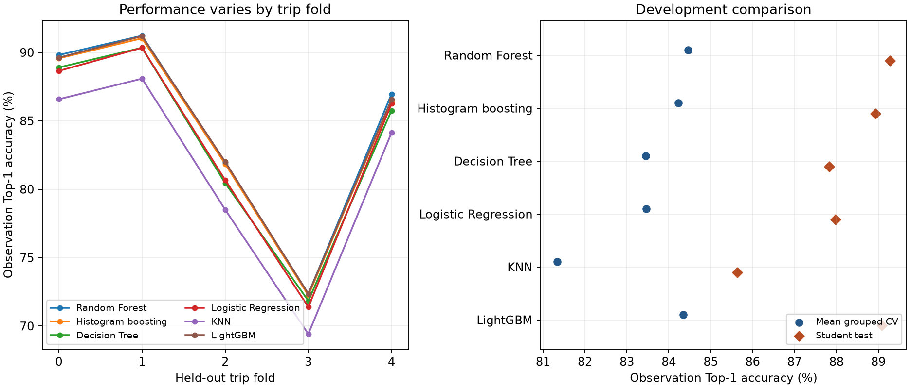

# 6. Model Comparison and Selection

**For completed GPS trips, we selected the Random Forest with 27 GPS and road features.** Its untuned configuration achieved **93.80%** mean trip-grouped validation Top-1 and **94.97%** student-test Top-1. The original eight-feature forest scored 84.46% and 89.28% on those measures. Most of the gain came from giving the classifier evidence about the vehicle’s approach to and departure from each candidate road.

The final pipeline uses a smaller Bayesian-tuned version of that forest. It scored **94.98%** alone. Its probabilities feed the selected HMM/Viterbi decoder, which scored **95.18%** after route reconstruction. [Section 7 — classifier tuning](07_random_forest_bayesian_optimisation.md) · [Section 8 — decoded routes](08_hmm_viterbi_route_reconstruction.md)

## Experimental design

The six baseline classifiers scored the same candidate roads using eight geometry and motion features. Each fold held out entire trips from the 80 training trips. Each model was then refitted on all 80 trips and scored on ten student-test trips. The five-fold mean gives each fold equal weight. The student-test Top-1 figure pools eligible observations across trips.

Top-1 counts an observation as correct when its highest-scoring candidate is the assigned road. Candidate accuracy, macro precision, macro recall and macro F1 evaluate binary candidate decisions at a probability threshold of 0.5. Macro metrics give the two candidate classes equal weight. Binary log loss evaluates the probabilities directly and penalises confident mistakes. Lower values are better.

The supplied reference is a sequence of traversed roads. Offline alignment assigned a road to **13,390 of 19,160** valid student-test GPS observations (69.89%). Among those assigned observations, **14** had their reference road missing from the generated candidates. These counted as Top-1 errors for every model. The scores below measure agreement with the inferred alignment on the development partitions. Ambiguous observations and the reserved evaluator trips are outside that accuracy estimate.

## Models and configurations

| Model | Algorithm family | Configuration used in the recorded run |
|---|---|---|
| Random Forest | Bagged decision-tree ensemble | 100 bootstrap trees, Gini splits, maximum depth 16, minimum leaf size 3, square-root feature sampling, two workers |
| LightGBM | Leaf-wise gradient-boosted tree ensemble | Binary objective, 200 trees, learning rate 0.05, up to 31 leaves, minimum leaf size 20, deterministic training with two workers |
| Histogram Gradient Boosting | Gradient-boosted tree ensemble | Log-loss objective, 100 iterations, learning rate 0.1, up to 31 leaves per tree, minimum leaf size 20, early stopping disabled |
| Logistic Regression | Linear probabilistic classifier | L2 regularisation, C = 1, LBFGS solver, up to 1,000 iterations, standardised features |
| Decision Tree | Single classification tree | Gini splits, maximum depth 12, minimum leaf size 5 |
| K-Nearest Neighbours (KNN) | Instance-based classifier | Five neighbours, uniform voting, Euclidean distance on standardised features |

Each pipeline fitted median imputation on its training fold. The logistic and KNN pipelines also fitted their scalers inside the fold.

## Six-classifier baseline comparison

All values in this table are percentages except log loss. CV F1 pools out-of-fold candidate predictions. Precision, recall, student F1 and candidate accuracy use the scored, labelled candidate rows from the student-test partition. Continuity uses classifier-only predictions on the student-test trips.

| Model | CV Top-1 | CV macro F1 | Student Top-1 | Candidate accuracy | Macro precision | Macro recall | Student macro F1 | Log loss | Route continuity |
|---|---:|---:|---:|---:|---:|---:|---:|---:|---:|
| **Random Forest** | **84.46** | 88.36 | **89.28** | **94.89** | **91.94** | 91.26 | 91.59 | 0.1317 | 87.65 |
| LightGBM | 84.35 | **88.41** | 89.08 | 94.84 | 91.49 | **91.74** | **91.61** | **0.1279** | 87.05 |
| Histogram Gradient Boosting | 84.23 | 88.38 | 88.92 | 94.81 | 91.40 | 91.73 | 91.57 | 0.1321 | 86.92 |
| Logistic Regression | 83.46 | 82.72 | 87.98 | 91.29 | 86.65 | 84.10 | 85.29 | 0.2275 | **87.72** |
| Decision Tree | 83.45 | 87.99 | 87.83 | 94.58 | 90.90 | 91.58 | 91.23 | 0.1707 | 84.57 |
| KNN | 81.34 | 86.80 | 85.64 | 93.88 | 89.75 | 90.46 | 90.10 | 0.6286 | 83.01 |

Random Forest made **1,668 false-positive** and **1,950 false-negative** candidate decisions. Histogram Gradient Boosting made **1,907 false positives** and **1,767 false negatives**, explaining its higher recall. LightGBM made **1,878 false positives** and **1,772 false negatives**. Its lower log loss (0.1279) makes its probabilities promising for decoder emissions, although that benefit still needs a sequence-level test. KNN had the highest log loss (0.6286). With five uniform votes, its scores take only six possible values, so ties and extreme scores can affect both ranking and decoder emissions.

## Stability and generalisation

| Model | Fold 0 | Fold 1 | Fold 2 | Fold 3 | Fold 4 | Fold standard deviation (pp) |
|---|---:|---:|---:|---:|---:|---:|
| Random Forest | 89.81 | 91.22 | 81.96 | 72.34 | 86.96 | 6.84 |
| LightGBM | 89.62 | 91.19 | 82.01 | 72.35 | 86.56 | 6.77 |
| Histogram Gradient Boosting | 89.57 | 91.03 | 81.85 | 72.24 | 86.47 | 6.77 |
| Logistic Regression | 88.65 | 90.34 | 80.67 | 71.39 | 86.25 | 6.86 |
| Decision Tree | 88.90 | 90.34 | 80.44 | 71.83 | 85.75 | 6.73 |
| KNN | 86.58 | 88.08 | 78.50 | 69.41 | 84.12 | 6.80 |

Random Forest led LightGBM in folds 0, 1 and 4. LightGBM led in folds 2 and 3. Random Forest averaged **0.11 percentage points** higher across folds and scored **0.19 points** higher on student-test Top-1. All six models performed worst on fold 3. The population standard deviation across the five forest fold scores was 6.84 points, so the trip mix matters much more to absolute performance than the gap between the two leading models. The close baseline results make the shared fold assignments important when measuring the effect of new features.

## Computational efficiency and model complexity

Fit time covers the final fit on the 80 training trips. Inference time covers classifier scoring of **113,648 student-test candidate rows**. Artifact size is the compressed, fitted pipeline in decimal MB. Times exclude candidate generation and Viterbi decoding.

| Model | Final fit (s) | Student-test inference (s) | Artifact (MB) |
|---|---:|---:|---:|
| Random Forest | 106.43 | 1.106 | 22.205 |
| LightGBM | 3.55 | 0.364 | 0.306 |
| Histogram Gradient Boosting | 2.89 | 0.160 | 0.178 |
| Logistic Regression | 0.45 | 0.014 | 0.0014 |
| Decision Tree | 7.91 | 0.042 | 0.080 |
| KNN | 0.54 | 5.335 | 40.375 |

The forest stores 100 trees and evaluates their votes for each candidate. Both boosting models produced smaller fitted artifacts at comparable Top-1 accuracy. LightGBM scored the student-test candidates in 0.364 s on its run. Logistic Regression had the fastest recorded inference. KNN fitted quickly but retained the training examples and spent the longest scoring new candidates. Timings were recorded on different team machines, so a strict deployment latency comparison requires a repeat benchmark on the intended API laptop.

## Effect of GPS context and final classifier choice

The context experiment kept the original candidates, labels, trip folds and 100-tree forest settings. It added 19 features to the original eight. One measures excess distance over the nearest candidate. The remaining 18 describe approach and departure at travel distances of 12, 40 and 90 metres. Each window measures directional alignment, the error between observed GPS position and travel along a candidate and a connecting road, and that error relative to the best candidate. Departure features use later observations, so the selected model is suited to completed trip uploads.

| Random Forest configuration | Mean CV Top-1 | Student-test Top-1 | Candidate accuracy | Macro precision | Macro recall | Macro F1 | Log loss | Route continuity before decoding |
|---|---:|---:|---:|---:|---:|---:|---:|---:|
| Eight features, 100 trees | 84.46% | 89.28% | 94.89% | 91.94% | 91.26% | 91.59% | 0.1317 | 87.65% |
| GPS context, 100 trees | 93.80% | 94.97% | 98.15% | 96.99% | 96.99% | 96.99% | 0.0485 | 90.24% |
| GPS context, tuned 64 trees | 93.78% | 94.98% | 98.12% | 96.96% | 96.89% | 96.93% | 0.0501 | 90.16% |

The 100-tree context forest improved on the original forest in all five folds. Its fold Top-1 scores were 94.64%, 96.92%, 91.42%, 90.69% and 95.33%. On the ten student-test trips it gained 762 correct observations and improved nine trips individually. Binary log loss fell from 0.1317 to 0.0485. The tuned and untuned context forests then gave nearly identical road-selection accuracy. We retained the 64-tree model for reconstruction because it was smaller, faster to score, and its emissions were evaluated with both decoders. The evidence for the feature change is stronger than the evidence for an accuracy gain from classifier tuning. [Paired feature comparison](../results/experiments/random_forest_gps_context/paired_trips.csv) · [Context forest metrics](../results/experiments/random_forest_gps_context/comparison.json) · [Tuned classifier metrics](../results/experiments/models/random_forest_gps_context_tuned/metrics.json)

The context models took 82.12 s and 26.52 s to fit, respectively. Their compressed pipelines occupy 19.08 MB and 5.98 MB. In a same-machine replay of both fitted pipelines, median classifier inference took 0.132 s and 0.082 s, respectively, for 113,648 candidate rows (five timed calls after one warm-up). Loading and constructing the shared context features took another 0.638 s in that replay. Each classifier provides one probability per trip, observation and candidate arc, which preserves the candidate identity for Viterbi traceback. [Untuned fitted model and metrics](../results/experiments/random_forest_gps_context/) · [Tuned fitted model and metrics](../results/experiments/models/random_forest_gps_context_tuned/)

## Evidence and reproducibility

The [six experiment folders](../results/baseline/models/) include the original five runs from revision `5159815` and the [LightGBM baseline](../results/baseline/models/lightgbm/) used in the baseline comparison. LightGBM 4.7.0 used one fixed configuration, followed the same five folds, and scored all 113,648 student-test candidates. Its saved pipeline reproduced those probabilities on reload. Each contains fold metrics, configuration, confusion matrix, timings and candidate scores. The [shared folds](../data/folds.csv), [decoder comparison](../results/decoder/baseline/decision_tree/comparison.json), and [continuity counts](figures/classifier_continuity.csv) support the tables. From the repository root, run `python report_sections/figures/plot_model_comparison.py` to regenerate the figure and continuity counts from saved predictions.

The two recorded data fingerprints can be reproduced by changing only the line endings in the fold CSV. The resulting trip memberships and assignments are identical. Random Forest used scikit-learn 1.9.0 and the other five used 1.9.1. This report compares the recorded runs directly. A repeat of the leading pair in one environment would strengthen the decision given their small margin.
