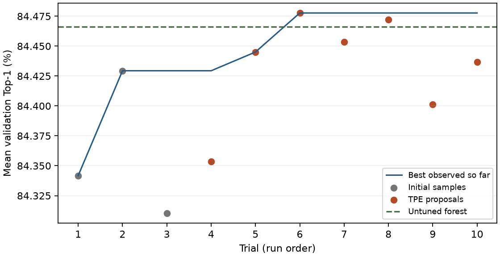

# 7. Bayesian hyperparameter optimisation of Random Forest

On the ten development test trips, observation Top-1 accuracy **decreased from 89.28% to 89.18%** (-0.10 percentage points). The tuned forest picked the assigned road for 11,941 of 13,390 labelled observations, compared with 11,955 for the untuned forest. Across the ten trips, accuracy rose on 3, fell on 5 and stayed equal on 2. These are reference-derived labels. Coverage on the student-test partition was 69.89%.

For road-selection accuracy, the original Random Forest remains the better-supported choice on these trips. The tuned model is a faster experimental alternative and is exported under the runner’s `final` ID for reproducibility. Its decoder has not been validated in this experiment.

## Search design

Section 6 selected Random Forest using mean observation Top-1 across five trip-grouped folds. We kept that objective: for each held-out trip, rank each observation’s road candidates by class-1 probability (breaking ties by lower arc ID). An assigned observation whose target is absent counts as incorrect. Pool observations within a fold and give each of the five folds equal weight. All 80 training trips retained their published fold assignments. Median imputation fitted within each fold. The search read only training-trip features and labels.

| Hyperparameter | Search space | Reason |
|---|---|---|
| Trees | 32–96, increments of 16 | Compare ensemble stability against training and scoring cost within the ten-trial budget. |
| Maximum depth | 12–26, integer | Span shallower and deeper interactions between distance, heading and movement. |
| Minimum samples per leaf | 1–12, integer on a log scale | Compare fine splits with more regularised probability estimates. |
| Bootstrap sample fraction per tree | 0.2–0.8, increments of 0.1 | Vary the number of training examples per tree, tree diversity and runtime. |

We used Optuna 4.9.0 with a seeded Tree-structured Parzen Estimator (TPE). The first three configurations established observations for the sampler. The remaining seven were proposed using previous training-fold results. All ten configurations received all five validation folds. Candidate generation, features, prediction rule and the 0.5 candidate-classification threshold remained fixed. The original forest (100 trees, depth 16, minimum leaf size 3, full-size bootstrap samples) was measured as a separate control. The finite search gives the best observed configuration in this space.

## Search and refit

Best trial **5** (zero-based trial ID) used **96 trees**, **depth 18**, **minimum leaf size 12** and a **20% bootstrap sample**. Its mean validation Top-1 was 84.48%. Its five fold scores were 89.87%, 91.29%, 81.92%, 72.25%, 87.05%. We froze these parameters, regenerated out-of-fold candidate scores, refitted on all 80 training trips, and scored the ten student-test trips with the saved model. The evaluator partition was excluded throughout.

## Tuned versus untuned

Both configurations below ran on the same machine using scikit-learn 1.9.1, seed 42, five workers, the same data fingerprint, and identical fold assignments. The original Section 6 run recorded 84.46% mean CV Top-1 and 89.28% student-test Top-1 on scikit-learn 1.9.0. The table uses its freshly reproduced configuration for the paired control. Percent metrics show percentage-point differences; loss and time show absolute differences.

| Metric | Untuned | Tuned | Change |
|---|---:|---:|---:|
| Mean-fold observation Top-1 | 84.47 | 84.48 | +0.01 |
| Pooled out-of-fold candidate macro F1 | 88.37 | 88.18 | -0.19 |
| Student-test observation Top-1 | 89.28 | 89.18 | -0.10 |
| Student-test candidate accuracy | 94.87 | 94.82 | -0.05 |
| Student-test candidate macro F1 | 91.57 | 91.45 | -0.13 |
| Student-test candidate log loss | 0.1318 | 0.1346 | +0.0028 |
| Final fit time (s) | 25.4951 | 7.3354 | -18.1597 |
| Student-test scoring time (s) | 0.2362 | 0.2016 | -0.0346 |

The optimisation objective increased by 0.01 percentage points. Selection over these folds makes the winning CV score a development estimate. Only the separate student-test comparison measures the transfer of that choice to other development trips.

## Computational cost and evidence

The Bayesian search used **50 fold fits** and took **6.57 minutes** including search input preparation. The complete experiment took **9.42 minutes** including the independent control, selected-configuration validation, final fits and scoring (macOS-27.0-arm64-arm-64bit). Classifier timings exclude candidate generation and sequence decoding.

Run `PYTHONPATH=src python -m pathsnap_ml.tune_random_forest --workspace .` from the repository root to reproduce this experiment. See the [trial log with parameters, fold scores and durations](../results/tuning/random_forest/trials.csv), [winning configuration](../results/tuning/random_forest/best.json), [paired metrics](../results/tuning/random_forest/comparison.json), [final scores and diagnostics](../results/baseline/models/final/), and [fitted classifier](../artifacts/final/).
