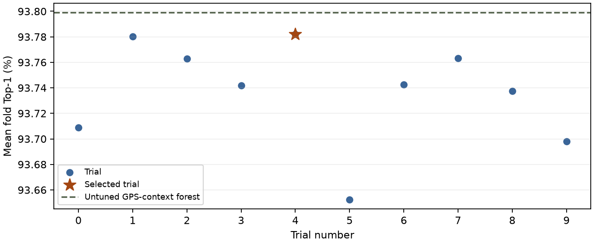

# 7. Bayesian hyperparameter optimisation of Random Forest

**The selected GPS-context Random Forest achieved 94.98% student-test Top-1 before decoding**. Bayesian tuning changed the count from 12,716 to 12,718 correct road assignments out of 13,390. Mean validation Top-1 moved from 93.80% to 93.78%. The practical benefit was efficiency: the tuned forest took 26.52 seconds to fit and occupied 5.98 MB, compared with 82.12 seconds and 19.08 MB for its untuned counterpart. Its candidate probabilities supply the emissions for route reconstruction. [Section 6 — feature and model selection](06_model_comparison_and_selection.md) · [Section 8 — accuracy after decoding](08_hmm_viterbi_route_reconstruction.md)

## Objective and search space

We used the 27 features selected in Section 6 and the five published folds of the 80 training trips. Each fold held out 16 complete trips. Median imputation was fitted on training-fold features. For each valid, labelled observation on a held-out trip, the forest ranked candidate roads by class-1 probability, breaking ties by lower arc ID. A missing reference candidate counted as an error. The search maximised the mean of the five fold Top-1 accuracies, giving each fold equal weight.

| Hyperparameter | Values searched | Reason |
|---|---|---|
| Trees | 32, 48, 64 | Test whether a smaller ensemble can preserve candidate rankings and reduce scoring cost. |
| Maximum depth | Integers from 14 to 26 | Vary how finely trees can model interactions between GPS movement and road geometry. |
| Minimum samples per leaf | Integers from 1 to 12, log sampled | Test the trade-off between local detail and more stable probability estimates. |
| Bootstrap fraction per tree | 0.15 to 0.45 in steps of 0.05 | Vary tree diversity and the cost of fitting each tree. |

Optuna’s Tree-structured Parzen Estimator used seed 42. Three initial random trials informed seven Bayesian proposals. Every trial received the same five folds. Trial 4 (numbered from zero) won with **64 trees, depth 14, minimum leaf size 5 and a 45% bootstrap sample**. Its fold Top-1 scores were 94.52%, 96.91%, 91.32%, 90.84% and 95.32%. We froze those settings, reproduced the five held-out scores, refitted the winner on all 80 training trips, and scored the ten student-test trips. The evaluator partition was excluded. [All ten trials, parameters, scores and durations](../results/experiments/models/random_forest_gps_context_tuned/trials.csv) · [Winning configuration](../results/experiments/models/random_forest_gps_context_tuned/best.json)

## Tuned versus untuned on the same trips

| Metric | Untuned GPS-context forest | Tuned GPS-context forest |
|---|---:|---:|
| Mean grouped validation Top-1 | 93.80% | 93.78% |
| Student-test observation Top-1 | 12,716 / 13,390 (94.97%) | 12,718 / 13,390 (94.98%) |
| Student-test candidate accuracy | 98.15% | 98.12% |
| Macro precision / recall / F1 | 96.99% / 96.99% / 96.99% | 96.96% / 96.89% / 96.93% |
| Candidate log loss | 0.0485 | 0.0501 |
| Final fit on 80 trips | 82.12 s | 26.52 s |

The 50 search fits and validation took 10.82 minutes. The full classifier experiment took 13.23 minutes including feature preparation, regeneration of held-out probabilities, final fitting and student-test scoring. Reloading the saved classifier reproduced all 113,648 student-test candidate probabilities. The slightly lower validation accuracy and higher log loss give little evidence that tuning improved generalisation. The gain from GPS context itself was much larger. [Untuned measurements](../results/experiments/random_forest_gps_context/comparison.json) · [Tuned measurements and confusion matrix](../results/experiments/models/random_forest_gps_context_tuned/metrics.json) · [Selected fitted pipeline](../results/experiments/models/random_forest_gps_context_tuned/model.joblib)

## Earlier eight-feature control

The initial search used the same grouped Top-1 objective and ten TPE trials on the original features. It selected 96 trees, depth 18, minimum leaf size 12 and a 20% bootstrap sample. In its matched control run, validation Top-1 changed from 84.47% to 84.48% and student-test Top-1 fell from 89.28% to 89.18%. That search took 6.57 minutes. Its saved artifact uses the earlier runner’s `final` identifier. The selected 27-feature model uses `random_forest_gps_context_tuned`. [Earlier search trials](../results/tuning/random_forest/trials.csv) · [Matched eight-feature comparison](../results/tuning/random_forest/comparison.json)

To reproduce the selected classifier experiment from the repository root, run `PYTHONPATH=src python -m pathsnap_ml.tune_context_routes`. It also evaluates the strict decoder. Section 8 gives the subsequent command for the selected decoder with a tuned segment-break cost.
