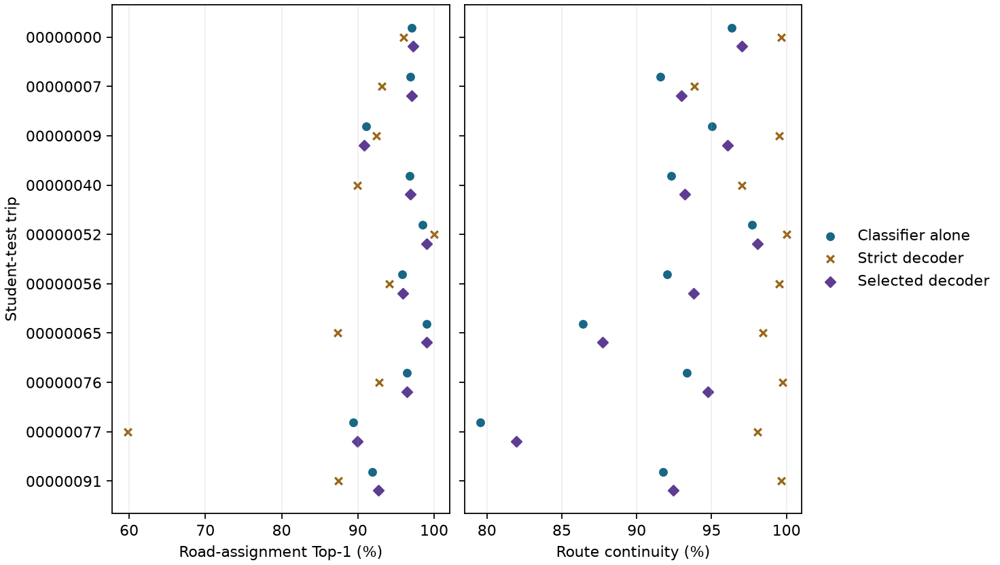

# 8. HMM and Viterbi route reconstruction

**The selected decoder achieved 95.18% student-test observation Top-1 and 91.61% route continuity.** It assigned the reference road at 12,745 of 13,390 labelled GPS observations on ten trips. The same tuned forest scored 94.98% before decoding. Both accuracy and continuity improved when the decoder could start a new route segment at a cost. [Section 7 — fitted classifier and Bayesian search](07_random_forest_bayesian_optimisation.md)

## Results on the ten student-test trips

All three outputs below use the same candidate roads and probabilities from the 64-tree GPS-context forest. The reference-derived labels cover 13,390 of 19,160 valid observations (69.89%). A missing prediction counts as a road-assignment error. Continuity is the fraction of eligible consecutive GPS pairs admitting a feasible directed transition. Each disconnected pair, including a segment break, counts as a failure. These are student-development measurements. The evaluator partition remains reserved.

| Output | Correct road assignments | Observation Top-1 | Feasible transitions | Continuity | Mean trip accuracy | Exact trip matches |
|---|---:|---:|---:|---:|---:|---:|
| Forest alone | 12,718 / 13,390 | 94.98% | 17,264 / 19,149 | 90.16% | 95.30% | 0 / 10 |
| Forest + strict Viterbi | 11,630 / 13,390 | 86.86% | 18,850 / 19,149 | 98.44% | 89.30% | 1 / 10 |
| **Forest + selected Viterbi** | 12,745 / 13,390 | 95.18% | 17,543 / 19,149 | 91.61% | 95.50% | 0 / 10 |

Mean trip accuracy weights each trip equally. An exact trip match requires the correct road at every labelled observation on that trip. Against the independent forest, the selected decoder corrected 94 assignments and introduced 67 errors, for a net gain of 27 correct assignments and 279 additional feasible transitions. Against strict Viterbi, it gained 1,115 correct assignments and lost 1,307 feasible transitions. Strict Viterbi produced the most connected routes. We selected the decoder with a segment-break cost because the primary objective is correct road identification after reconstruction.

| Trip | Labelled observations | Forest Top-1 | Selected Viterbi Top-1 | Forest continuity | Selected Viterbi continuity |
|---|---:|---:|---:|---:|---:|
| `00000000` | 2,298 | 97.08% | 97.26% | 96.32% | 97.04% |
| `00000007` | 1,276 | 96.87% | 97.10% | 91.57% | 92.98% |
| `00000009` | 608 | 91.12% | 90.79% | 95.04% | 96.09% |
| `00000040` | 2,620 | 96.79% | 96.87% | 92.28% | 93.22% |
| `00000052` | 200 | 98.50% | 99.00% | 97.70% | 98.08% |
| `00000056` | 2,044 | 95.79% | 95.94% | 92.04% | 93.81% |
| `00000065` | 420 | 99.05% | 99.05% | 86.42% | 87.73% |
| `00000076` | 932 | 96.46% | 96.46% | 93.33% | 94.75% |
| `00000077` | 2,364 | 89.42% | 89.89% | 79.54% | 81.97% |
| `00000091` | 628 | 91.88% | 92.68% | 91.75% | 92.44% |

Nine trips exceeded 90% decoded accuracy. Trip `00000077` scored 89.89%. [Classifier-only and strict decoder measurements](../results/decoder/experiments/random_forest_gps_context_tuned/comparison.json) · [Selected per-trip measurements](../results/decoder/experiments/random_forest_gps_context_tuned_segment_breaks/hmm/student_test/metrics.json)

## Hidden states, transitions and traceback

At each observation, a hidden state identifies a candidate arc and the projected GPS position on that arc. The tuned forest supplies an emission weight for that candidate. The decoder uses its log score, `log(max(p_match, 1e-9))`. The independent classifier picks the highest-scoring candidate at each observation.

For a pair of consecutive candidates, let *D* be the shortest directed travel distance between the projected positions and *G* the straight-line GPS displacement, both in metres. The router includes the traversed portions of the first and last arcs. A feasible transition has a log weight of `−abs(D − G) / β`. The speed bound is `55 × elapsed_seconds + 30` metres. With the selected decoder, a pair that exceeds the bound or lacks a directed path may start a new segment with log weight `−break_penalty`. In the strict decoder that pair has zero transition weight and triggers a restart only if no candidate sequence can continue.

For each current candidate, Viterbi adds its log emission to the largest predecessor score plus transition log weight. It stores that predecessor, then traces backward from the highest-scoring terminal state. Invalid observations, absent candidates and GPS gaps over 60 seconds split the runs. Traceback through an infeasible pair produces an explicit segment break in the route export. For connected pairs the export includes any intermediate arcs. The selected routes contain 1,606 unreachable-transition breaks and one large GPS gap across the ten trips. [Reconstructed routes and break records](../results/decoder/experiments/random_forest_gps_context_tuned_segment_breaks/hmm/student_test/routes.json)

## Choosing the decoder settings

The strict comparison tried transition scales of 20, 50 and 100 metres on out-of-fold forest probabilities. It selected 100 metres by pooled decoded training accuracy. For the final decoder, a Bayesian TPE search (seed 42) evaluated ten settings using all 80 training trips, each scored by a forest that had held out that trip. The objective was mean observation Top-1 **after Viterbi traceback** over the five published folds. The search used log scales for the distance parameter β (10–150 metres) and the cost of a new segment (0.5–8 log-score units).

Trial 4 selected **β = 138.12 metres** and a **segment-break cost of 0.526**. Its five validation scores were 94.87%, 97.16%, 91.45%, 90.97% and 95.45%, averaging **93.98%**. The search took 4.42 minutes. We froze these settings before scoring the ten student-test trips. Those trips had already been used for earlier development comparisons. [Strict decoder scale trials](../results/decoder/experiments/random_forest_gps_context_tuned/decoder_config.json) · [Bayesian decoder trials](../results/decoder/experiments/random_forest_gps_context_tuned_segment_breaks/trials.csv) · [Selected configuration and training-score fingerprint](../results/decoder/experiments/random_forest_gps_context_tuned_segment_breaks/decoder_config.json)

## Earlier reconstruction experiment and reproduction

With the original eight-feature untuned forest, strict Viterbi changed student-test accuracy from 89.28% to 86.27% and continuity from 87.65% to 98.44%. The comparison above uses the 27-feature tuned forest throughout, isolating the effect of the decoder. [Original eight-feature route comparison](../results/decoder/baseline/random_forest/comparison.json)

To reproduce the selected decoder from its committed classifier scores, run `PYTHONPATH=src python -m pathsnap_ml.tune_viterbi` from the repository root. Regenerate the Section 7 and 8 figures with `python report_sections/figures/plot_context_forest.py`. [Decoded observation predictions](../results/decoder/experiments/random_forest_gps_context_tuned_segment_breaks/hmm/student_test/predictions.parquet)
