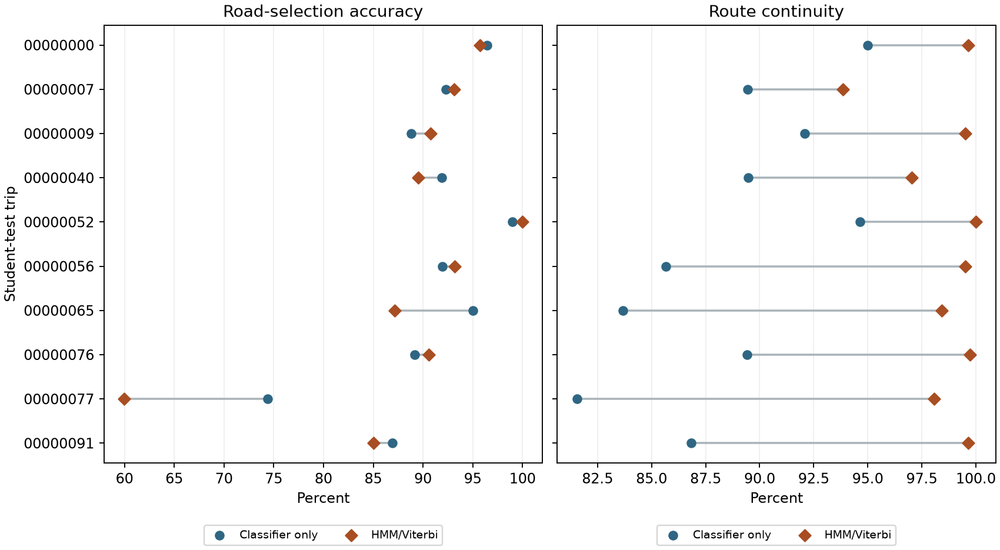

# 8. HMM and Viterbi Route Reconstruction

**Using the untuned Random Forest, Viterbi decoding changed observation-level accuracy from 89.28% to 86.27% (-3.01 pp) and route continuity from 87.65% to 98.44% (+10.79 pp).** Both modes used the original Section 6 forest (100 trees, depth 16, minimum leaf size 3) and the same saved candidate probabilities for the same ten student-test trips. The classifier-only accuracy reproduces the Section 6 result.

## What changed on the ten student-test trips

| Measured outcome | Classifier only | Classifier + HMM/Viterbi | Change |
|---|---:|---:|---:|
| Correct reference-road assignments | 11,954/13,390 (89.28%) | 11,551/13,390 (86.27%) | -3.01 pp |
| Feasible consecutive transitions | 16,784/19,149 (87.65%) | 18,850/19,149 (98.44%) | +10.79 pp |
| Mean per-trip pointwise accuracy | 90.59% | 88.50% | -2.09 pp |
| Trips with all assigned observations correct | 0.00% | 10.00% | +10.00 pp |

Among paired labelled observations, decoding corrected **480** previously wrong assignments and changed **883** previously correct assignments to a different road. The net change was **-403** correct assignments. Accuracy improved on 5 trips, fell on 5, and was tied on 0. Continuity improved on all ten trips.

**Metric definitions.** Pointwise accuracy counts correct predicted arc IDs among the 13,390 valid observations with an assigned reference-derived road (69.89% of 19,160 student-test observations). A missing prediction counts as incorrect. Mean trip accuracy weights each trip equally. Exact trip match requires the correct road at every labelled observation on that trip. Continuity counts feasible transitions between consecutive valid observations within 60 seconds, using the same directed-road and speed constraints in both modes. Missing predictions or unreachable transitions fail the continuity check, including at a decoder restart. Continuity needs no reference labels and therefore has a different denominator. A feasible route can still follow a different road from the reference.

| Trip | Labelled observations | Accuracy before | Accuracy after | Accuracy change | Continuity before | Continuity after |
|---|---:|---:|---:|---:|---:|---:|
| `00000000` | 2,298 | 96.43% | 95.74% | -0.70 pp | 95.00% | 99.64% |
| `00000007` | 1,276 | 92.32% | 93.10% | +0.78 pp | 89.43% | 93.87% |
| `00000009` | 608 | 88.82% | 90.79% | +1.97 pp | 92.08% | 99.52% |
| `00000040` | 2,620 | 91.91% | 89.50% | -2.40 pp | 89.48% | 97.03% |
| `00000052` | 200 | 99.00% | 100.00% | +1.00 pp | 94.64% | 100.00% |
| `00000056` | 2,044 | 91.93% | 93.20% | +1.27 pp | 85.67% | 99.52% |
| `00000065` | 420 | 95.00% | 87.14% | -7.86 pp | 83.68% | 98.43% |
| `00000076` | 932 | 89.16% | 90.56% | +1.39 pp | 89.43% | 99.73% |
| `00000077` | 2,364 | 74.41% | 59.94% | -14.47 pp | 81.56% | 98.08% |
| `00000091` | 628 | 86.94% | 85.03% | -1.91 pp | 86.83% | 99.66% |

## How the decoder uses forest probabilities

Each hidden state is a candidate road segment at a GPS observation, with its projected position on that segment. The classifier-only baseline independently selects the highest probability at each observation, breaking ties by lower arc ID. The HMM uses the same scores as emission weights. For candidate *j* at observation *t*, the log emission is `log(max(p_match, 1e-9))`.

For consecutive candidates *i* and *j*, the router computes the shortest feasible directed travel distance between their projected positions, including partial first and last arcs. Let this distance be *D* metres and the GPS displacement be *G* metres. A reachable transition contributes `−|D − G| / β`; a transition above `55 × elapsed_seconds + 30` metres or with no directed path is impossible. Smaller β penalises distance discrepancies more heavily.

Viterbi accumulates the emission plus the best predecessor’s accumulated score and transition weight, then backtracks through stored predecessors to recover a road sequence per connected run. It starts a new run at a gap over 60 seconds, after an invalid observation or empty candidate set, or if every transition is impossible. Such breaks remain explicit in the exported routes. The number of infeasible transitions fell from 2,365 with the classifier alone to 299 after decoding. The route exports preserve intermediate connecting arcs where available.

## Choosing the transition scale

We evaluated the three existing project search values on the **80 training trips**. Every emission for these trials came from a forest that had held out the observation’s entire trip. We maximised pooled pointwise accuracy across assigned training observations, with smaller β as a deterministic tie-break. Candidate sets, emissions, gap limit, speed bound and slack were identical across trials. The winning **β = 50 m** was frozen before student-test scoring. No evaluator trips entered selection or evaluation.

| β (m) | Correct / labelled training observations | OOF decoded accuracy |
|---:|---:|---:|
| 20 | 105,131/138,093 | 76.13% |
| 50 | 105,142/138,093 | 76.14% |
| 100 | 105,114/138,093 | 76.12% |

## Interpretation and reproducibility

For this development set, the independent forest predictions retain the higher road-selection accuracy, while Viterbi gives the more continuous route. The accuracy labels were inferred from the supplied route sequences. The measurements support a choice between output modes for these trips; they do not establish official evaluator accuracy.

Run `PYTHONPATH=src python -m pathsnap_ml.evaluate_forest_routes --workspace .` from the repository root. Regenerate the paired counts and figure with `python report_sections/figures/plot_forest_routes.py`. The [frozen configuration and training score fingerprint](../results/decoder/baseline/random_forest/decoder_config.json), [240 training trip/setting results](../results/decoder/baseline/random_forest/training_trials_by_trip.csv), [student-test metrics](../results/decoder/baseline/random_forest/comparison.json), [paired trip table](../results/decoder/baseline/random_forest/paired_trips.csv), [classifier-only routes](../results/decoder/baseline/random_forest/classifier_only/student_test/), and [decoded routes](../results/decoder/baseline/random_forest/hmm/student_test/) accompany this report.
